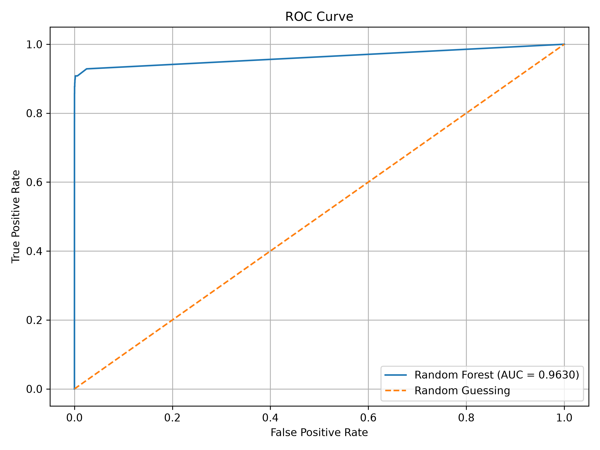
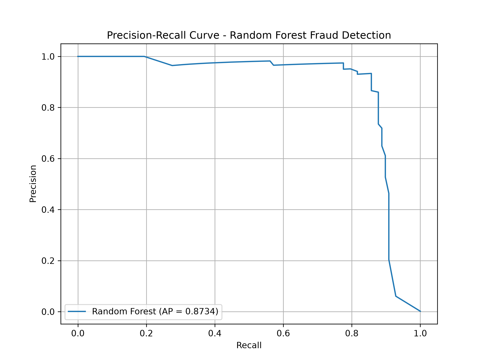
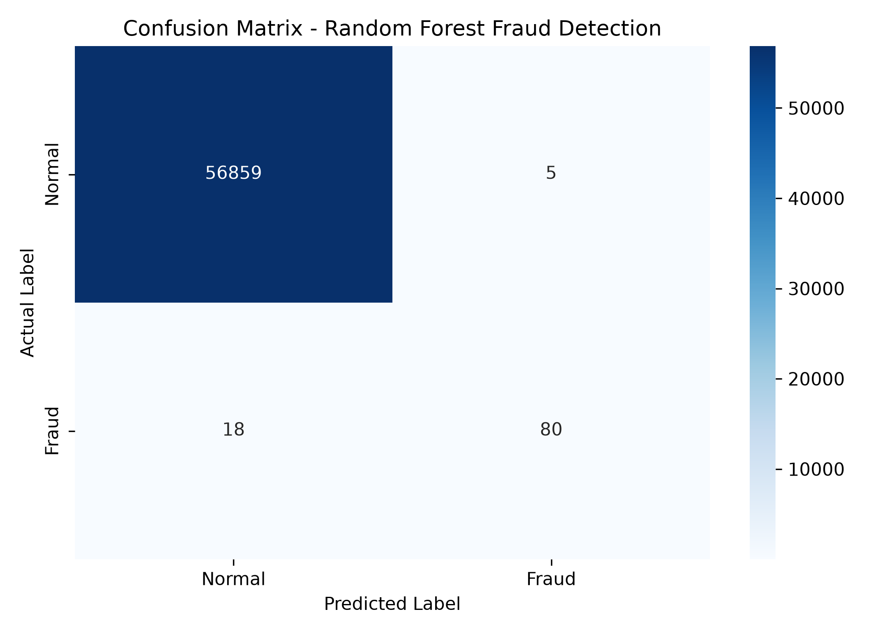
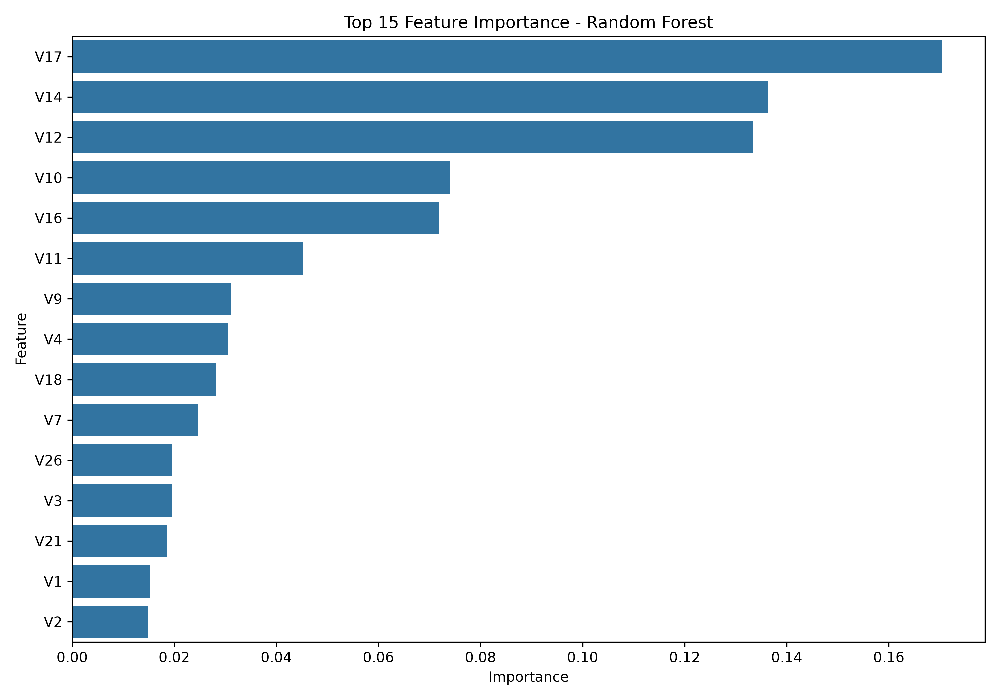

# Fraud Detection in Highly Imbalanced Financial Transactions Using Machine Learning

## Overview

This project detects fraudulent credit card transactions using machine learning. It is a highly imbalanced classification problem: the dataset contains 284,807 transactions, of which only 492 (approximately 0.17%) are fraudulent.

Accuracy alone is not a useful measure for this problem. The experiments therefore focus on Precision, Recall, F1-Score, ROC-AUC, PR-AUC, and the confusion matrix. Several models and imbalance-handling approaches were compared before selecting the final model.

## Problem Statement

Fraudulent transactions are rare compared with legitimate transactions. A classifier that predicts every transaction as legitimate would still be approximately 99.83% accurate while detecting no fraud.

The goal is to identify fraudulent transactions while keeping false alarms at a practical level.

## Dataset

Dataset: **Credit Card Fraud Detection**. The data contains anonymized credit card transactions.

### Dataset Statistics

| Statistic               |   Value |
| ----------------------- | ------: |
| Total transactions      | 284,807 |
| Legitimate transactions | 284,315 |
| Fraudulent transactions |     492 |
| Fraud rate              |  ~0.17% |
| Features                |      30 |
| Target                  | `Class` |

| Class | Meaning                |
| ----: | ---------------------- |
|     0 | Normal transaction     |
|     1 | Fraudulent transaction |

Features `V1` to `V28` are anonymized numerical features produced through a PCA transformation. `Time` is the number of seconds elapsed between transactions, `Amount` is the transaction amount, and `Class` is the target. The original dataset is excluded from the repository through `.gitignore`.

## Project Workflow

```text
Dataset → Exploratory Data Analysis → Stratified Train-Test Split → Feature Scaling
  → Baseline and Imbalance Experiments (Logistic Regression, Class Weight, SMOTE)
  → Random Forest and XGBoost → Model Comparison → Validation-Based Threshold Selection
  → Final Random Forest → Evaluation, Visualizations, and Saved Model
```

## Exploratory Data Analysis

- **Class imbalance:** 284,315 normal transactions and 492 fraudulent transactions. This makes accuracy unreliable as the primary metric.
- **Transaction amount:** `Amount` is strongly right-skewed. A small number of transactions have large amounts, which are not automatically fraudulent, so outliers were not removed blindly.
- **Time:** Fraud appears sporadically over the transaction timeline; `Time` alone is not sufficient to identify fraud.
- **Anonymized features:** Several `V` features have different distributions for normal and fraudulent transactions, but their real-world meaning cannot be interpreted directly.

## Preprocessing

The data was divided using a stratified split, preserving the fraud rate in each partition:

| Partition | Transactions |
| --------- | -----------: |
| Training  |      227,845 |
| Testing   |       56,962 |

`StandardScaler` was applied to `Time` and `Amount`. It was fitted only on the training data and then applied to the test data to prevent data leakage. `class_weight="balanced"` and SMOTE were also evaluated. SMOTE was applied only to training data; the test set retained its original class distribution.

## Model Experiments

The following models and approaches were evaluated:

1. Logistic Regression as the baseline.
2. Logistic Regression with `class_weight="balanced"` to give more weight to fraud cases.
3. Logistic Regression with SMOTE applied to the training data.
4. Random Forest with 100 decision trees.
5. XGBoost as a gradient boosting approach.

## Model Comparison

Results below are from the untouched test set.

| Model                          | Precision |  Recall | F1-Score |    ROC-AUC |     PR-AUC |
| ------------------------------ | --------: | ------: | -------: | ---------: | ---------: |
| Logistic Regression            |       83% |     64% |      72% |     95.59% |     74.32% |
| Logistic Regression + Balanced |        6% |     92% |      11% |     97.22% |     71.59% |
| Logistic Regression + SMOTE    |        6% |     92% |      11% |     96.99% |     72.49% |
| **Random Forest**              |   **94%** | **82%** |  **87%** | **96.30%** | **87.34%** |
| XGBoost                        |       92% |     78% |      84% |     95.50% |     84.11% |

Random Forest provided the strongest overall balance across Precision, Recall, F1-Score, and PR-AUC. Balanced Logistic Regression had higher recall but produced many more false positives, so Random Forest was selected as the final model.

## Threshold Tuning

Threshold analysis was used to examine the Precision-Recall trade-off. A separate validation set was created from the original training data to select the threshold, rather than selecting it directly on the test set.

```text
Selected threshold: 0.50
```

The final Random Forest was retrained on the complete training set and evaluated once on the untouched test set. This keeps test-set performance out of the threshold-selection process.

## Final Random Forest Results

| Metric    |      Score |
| --------- | ---------: |
| Precision | **94.12%** |
| Recall    | **81.63%** |
| F1-Score  | **87.43%** |
| ROC-AUC   | **96.30%** |
| PR-AUC    | **87.34%** |

### Confusion Matrix

Rows are actual labels and columns are predicted labels.

```text
                Predicted
              Normal  Fraud
Actual Normal  56859     5
       Fraud      18    80
```

- True Negatives: **56,859**
- False Positives: **5**
- False Negatives: **18**
- True Positives: **80**

The model identified 80 of the 98 fraudulent transactions in the test set with 5 false positives.

## Evaluation Visualizations

### ROC Curve

The ROC curve shows how well the model separates fraudulent and legitimate transactions across thresholds. The final model achieved ROC-AUC **0.9630**.



### Precision-Recall Curve

Precision-Recall analysis is especially useful for this highly imbalanced dataset. The final model achieved PR-AUC **0.8734**.



### Confusion Matrix



### Feature Importance

The most important Random Forest features were `V17`, `V14`, `V12`, `V10`, and `V16`. Since `V1`–`V28` are anonymized PCA-transformed features, importance indicates predictive contribution rather than direct financial meaning.



## Saved Model

The final model and preprocessing artifacts are stored in `models/`:

```text
models/
├── random_forest_fraud.pkl
├── scaler.pkl
└── threshold.pkl
```

These files can be loaded to reuse the trained model, feature scaler, and classification threshold without retraining.

## Project Structure

```text
fraud-detection-ml/
├── data/
│   └── creditcard.csv                 # Excluded from Git
├── models/
│   ├── random_forest_fraud.pkl
│   ├── scaler.pkl
│   └── threshold.pkl
├── results/
│   ├── figures/
│   │   ├── roc_curve.png
│   │   ├── precision_recall_curve.png
│   │   ├── confusion_matrix.png
│   │   └── feature_importance.png
│   └── metrics/
│       └── final_metrics.txt
├── src/
│   ├── eda.py
│   ├── preprocessing.py
│   ├── train.py
│   ├── evaluate_baseline.py
│   ├── evaluate_balanced.py
│   ├── evaluate_smote.py
│   ├── evaluate_random_forest.py
│   ├── evaluate_xgboost.py
│   ├── evaluate_threshold.py
│   ├── evaluate_threshold_validation.py
│   ├── evaluate_random_forest_balanced.py
│   ├── evaluate_roc_curve.py
│   ├── evaluate_pr_curve.py
│   ├── evaluate_confusion_matrix.py
│   ├── evaluate_feature_importance.py
│   └── save_final_model.py
├── .gitignore
├── README.md
└── requirements.txt
```

## Technologies

- Python
- Pandas and NumPy
- Scikit-learn
- Imbalanced-learn
- XGBoost
- Matplotlib and Seaborn
- Joblib

## Key Takeaways

- Handle severe class imbalance with metrics beyond accuracy.
- Use stratified splitting and fit preprocessing only on training data.
- Compare class weighting and SMOTE while preserving the original test distribution.
- Use validation data for threshold selection and keep the test set untouched.
- Analyze Precision and Recall together, especially for fraud detection.
- Save the model and preprocessing artifacts for reuse.

The final Random Forest achieved an F1-Score of **87.43%** and PR-AUC of **87.34%** on the untouched test set, balancing fraud detection with a low number of false alarms.
